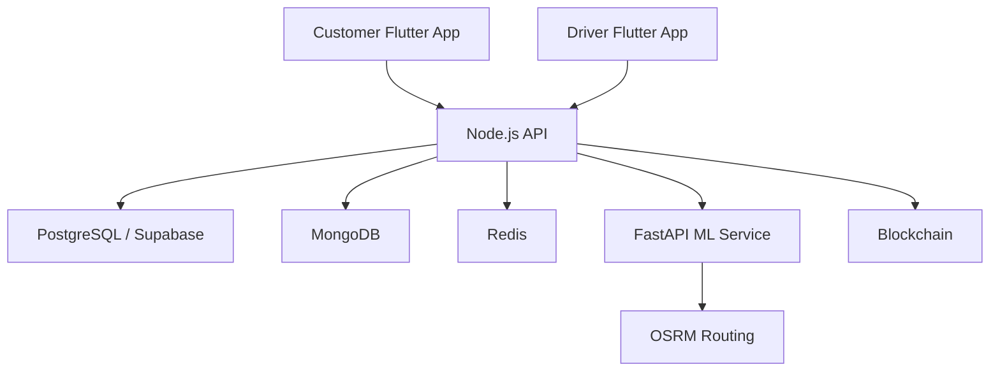

# 🚛 Truxify

### Broker-Free · ML-Powered · Blockchain-Secured Freight Platform

**Directly connecting manufacturers and truck drivers — eliminating middlemen, maximising earnings, and bringing transparency to India's freight industry.**

[](https://flutter.dev)
[](https://nodejs.org)
[](https://fastapi.tiangolo.com)
[](https://polygon.technology)
[](LICENSE)
[](CONTRIBUTING.md)

---

## 📌 Overview

Truxify is an open-source freight marketplace designed to connect manufacturers directly with truck drivers.

The platform aims to improve freight transportation through:

- **Direct Connections:** Connecting manufacturers and drivers without unnecessary intermediaries.
- **Smart Matching:** Matching available trucks with freight requirements.
- **Live Tracking:** Providing shipment visibility through location tracking.
- **Transparent Payments:** Supporting secure and transparent payment workflows.
- **Open Source:** Encouraging developers to contribute and improve the platform.

## 🔴 The Problem

Traditional freight transportation often involves several challenges:

| Pain Point | Impact |
|---|---|
| Multiple intermediaries | Reduced driver earnings |
| Manual booking processes | Delayed transportation |
| Empty return trips | Increased fuel costs |
| Limited shipment visibility | Poor coordination |
| Payment delays | Financial difficulties |
| Document verification issues | Reduced trust |

## ✅ The Solution

Truxify aims to address these challenges through a digital freight marketplace.

| Feature | Purpose |
|---|---|
| Direct Freight Matching | Connect manufacturers with truck drivers |
| Smart Recommendations | Improve truck and load matching |
| Shipment Tracking | Monitor transportation progress |
| Digital Documentation | Improve document management |
| Payment Management | Support transparent transactions |
| Open-Source Development | Enable community contributions |

## 🏗️ Architecture

The proposed platform architecture includes the following components:



### Component Responsibilities

| Component | Technology | Responsibility |
|---|---|---|
| Mobile Applications | Flutter | Customer and driver interfaces |
| API Gateway | Node.js and Express | Backend services |
| ML Service | FastAPI and Python | Matching and prediction |
| Database | PostgreSQL | Structured data storage |
| Telemetry | MongoDB | Location and activity data |
| Cache | Redis | Temporary data management |
| Blockchain | Polygon and Solidity | Smart contract integration |
| Routing | OSRM | Route calculations |

## 🧠 Machine Learning Layer

The planned ML capabilities include:

1. Two-Sided Freight Matching
2. Driver Profit Prediction
3. Route Optimization
4. Recommendation System
5. Dynamic Price Prediction
6. ETA Prediction
7. Trust and Risk Scoring
8. Return-Load Matching
9. Demand Forecasting
10. Mid-Trip Load Optimization

## ⛓️ Blockchain Layer

The proposed blockchain integration focuses on:

- Secure payment escrow.
- Document hash verification.
- Digital delivery receipts.
- Transparent transaction records.
- Driver reputation management.

## ⚙️ Automation and Voice AI

Planned automation capabilities include:

- Shipment status notifications.
- Delivery monitoring.
- Dispute management workflows.
- Automated system monitoring.
- Voice-based shipment enquiries.

## 📱 Mobile Applications

### Customer App

- Create freight requests.
- View available trucks.
- Compare transportation options.
- Track shipments.
- Monitor delivery status.

### Driver App

- Browse available freight.
- View matching loads.
- Check estimated earnings.
- Track active journeys.
- Manage delivery information.

## 🛠️ Tech Stack

| Category | Technology |
|---|---|
| Frontend | Flutter, Dart |
| Backend | Node.js, Express |
| ML | Python, FastAPI |
| Database | PostgreSQL, Supabase |
| NoSQL Database | MongoDB |
| Cache | Redis |
| Blockchain | Solidity, Polygon |
| Routing | OSRM, OpenStreetMap |
| Automation | n8n |
| Containerization | Docker |
| Version Control | Git, GitHub |

## 🚀 Getting Started

### Prerequisites

Install the following tools:

- Flutter SDK
- Node.js
- Python
- Git
- Docker

### Clone Repository

```bash
git clone https://github.com/KanishJebaMathewM/Truxify.git

cd Truxify
```

### Backend Setup

```bash
cd backend/api

npm install

npm start
```

### Flutter Setup

For the customer application:

```bash
cd apps/customer

flutter pub get

flutter run
```

For the driver application:

```bash
cd apps/driver

flutter pub get

flutter run
```

### ML Service Setup

```bash
cd backend/ml

python -m venv venv
```

Activate the environment.

Windows:

```bash
venv\Scripts\activate
```

Linux/macOS:

```bash
source venv/bin/activate
```

Install dependencies:

```bash
pip install -r requirements.txt
```

Run the service:

```bash
uvicorn main:app --reload --port 8000
```

## 🧪 Testing

Run the relevant tests before submitting changes.

```bash
# Backend tests
cd backend/api
npm test

# Flutter analysis
cd apps/customer
flutter analyze

# Flutter tests
flutter test

# ML tests
cd ../../backend/ml
pytest
```

## 🗺️ Roadmap

- [x] Project foundation and initial application structure
- [x] Customer and driver application development
- [ ] Backend integration
- [ ] Freight matching improvements
- [ ] Machine learning integration
- [ ] Blockchain integration
- [ ] Voice AI integration
- [ ] Production testing and deployment

## 🤝 Contributing

Contributions are welcome!

1. Read the [Contribution Guidelines](CONTRIBUTING.md).
2. Fork the repository.
3. Create a new branch.

```bash
git checkout -b feat/your-feature
```

4. Make your changes.
5. Run the relevant tests.
6. Submit a Pull Request.

## 👥 Contributors

Thank you to everyone contributing to Truxify!

[](https://github.com/KanishJebaMathewM/Truxify/graphs/contributors)

## 📄 License

This project is licensed under the [MIT License](LICENSE).

---

<div align="center">

**Built with ❤️ for India's trucking community.**

⭐ Star this repository if you support open-source freight innovation!

[Report a Bug](https://github.com/KanishJebaMathewM/Truxify/issues) · [Request a Feature](https://github.com/KanishJebaMathewM/Truxify/issues)

</div>
