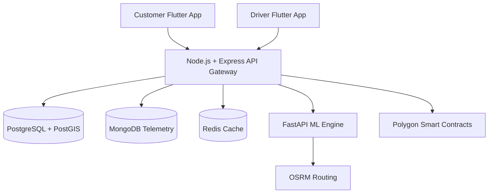

# 🚛 Truxify

### Broker-Free · ML-Powered · Blockchain-Secured Freight Platform

**Directly connecting manufacturers and truck drivers — eliminating middlemen, maximising earnings, and bringing transparency to India's ₹14 lakh crore freight industry.**

[](https://flutter.dev)
[](https://nodejs.org)
[](https://fastapi.tiangolo.com)
[](https://polygon.technology)
[](https://discord.gg/7MhyE48Au)
[](LICENSE)
[](CONTRIBUTING.md)

[Overview](#-overview) · [Community](#-community--discussion) · [The Problem](#-the-problem) · [The Solution](#-the-solution) · [Architecture](#-architecture) · [ML Layer](#-ml-layer) · [Blockchain](#-blockchain-layer) · [Getting Started](#-getting-started) · [Testing](#-testing) · [Roadmap](#-roadmap) · [Contributing](#-contributing)

---

## 💬 Community & Discussion

Join our Discord community to connect with maintainers, contributors, and developers working on Truxify and other open-source projects!

[](https://discord.gg/7MhyE48Au)

- 🚚 **Truxify Discussions**: Get help with local setup, brainstorm feature requests, discuss pull requests, and talk architecture.
- 🌐 **Open Source Collaborations**: Collaborate across open-source initiatives, share best practices, and coordinate contributions.
- 💡 **Developer Support**: Connect directly with fellow developers building Flutter apps, Node.js microservices, ML pipelines, and smart contracts.

👉 **[Click here to join our Discord Server: https://discord.gg/7MhyE48Au](https://discord.gg/7MhyE48Au)**

---

## 📌 Overview

Truxify is an open-source, broker-free freight marketplace engineered to connect manufacturers directly with truck drivers across India's national highway network.

India has over 1.4 crore registered trucks. Today, most drivers earn subsistence wages after commission chains and middlemen siphon 30–40% of booking revenues. Trucks routinely return empty (deadheading), wasting fuel and money. Small and medium manufacturers spend 6+ hours calling unverified broker networks to secure transport with zero real-time visibility.

Truxify resolves all three challenges simultaneously:
- **Zero Commission Gouging**: Direct bilateral matching eliminating multi-tier brokerage.
- **Deadhead Elimination**: Continuous en-route and return-trip load optimization.
- **Trustless Execution**: Polygon smart contract payment escrow, tamper-evident document hashing, and immutable on-chain reputation.

---

## 🔴 The Problem

```text
Manufacturer ──▶ Broker ──▶ Sub-Broker ──▶ Truck Owner ──▶ Driver
     ✅             💸           💸             💸           😔
```

By the time freight payments reach the person doing the driving, 30–40% has vanished into middlemen margins.

| Pain Point | Who Suffers | Real-World Impact |
|---|---|---|
| **30–40% broker cuts** | Truck drivers | Severe margin loss on every single trip |
| **6+ hours phone chains** | Manufacturers | Delayed dispatch, operational bottlenecks |
| **Empty return deadhead** | Drivers & Environment | ₹30,000+ lost per empty return run |
| **Zero live shipment tracking** | Manufacturers | Blind supply chains once the truck departs |
| **30–60 day payment delays** | Drivers | Crippling working-capital and fuel cashflow |
| **Document fraud & fake RC** | Both parties | Cargo theft, uninsured damages, zero recourse |

Traditional freight aggregators digitised brokers without eliminating them, focusing on large corporate fleets. Truxify is built for the independent single-truck owner and SME manufacturer.

---

## ✅ The Solution

```text
Manufacturer ──────────────────────────────────────────────── Driver
                           TRUXIFY
           ML Matching · Smart Contract Escrow
           Voice AI · Live Tracking · n8n Pipelines
```

| Feature | Legacy Aggregators (BlackBuck / Vahak) | Truxify Platform |
|---|---|---|
| **Open Source** | ❌ Closed, proprietary platform | ✅ 100% open-source & self-hostable |
| **Target User** | Large fleets, corporate MNCs | Independent truck owners & SME manufacturers |
| **ML Matching** | Basic rule-based dispatch | 10-model bilateral matching & 3D VRP |
| **Blockchain** | None | Trustless escrow, hashed docs & portable ratings |
| **Deadhead Elimination** | Passive / manual board search | Real-time en-route mid-trip load re-optimization |
| **Voice AI** | None | Multilingual WebRTC + Whisper + LLM + ElevenLabs |
| **Payment Release** | Delayed 30–60 days | Automated UPI instant release upon verified delivery |
| **Commission** | Aggregator takes platform cut | Transparent, minimal, driver-first economics |

---

## 🏗️ Architecture

Truxify is architected across 6 distinct, decoupled layers:



```text
┌─────────────────────────────────────────────────────────┐
│                    FLUTTER APPS                          │
│         Customer App          Driver App                 │
└──────────────────┬──────────────────┬───────────────────┘
                   │                  │ REST + WebSockets
┌──────────────────▼──────────────────▼───────────────────┐
│              NODE.JS + EXPRESS (Main API Gateway)        │
│     Auth · Bookings · Payments · WebSocket Server        │
└────┬──────────────┬──────────────────┬──────────────┬────┘
     │              │                  │              │
┌────▼────┐  ┌──────▼──────┐    ┌──────▼──────┐ ┌─────▼──────────────────┐
│ FASTAPI │  │  SUPABASE   │    │   MONGODB   │ │ POLYGON SMART CONTRACT │
│   ML    │  │  PostgreSQL │    │  GPS Trail  │ │ Escrow · Docs · Repute │
│ Models  │  │  + PostGIS  │    │  Audit Logs │ └────────────────────────┘
└────┬────┘  └─────────────┘    └─────────────┘
     │
┌────▼────┐
│  OSRM   │
│ Routing │
└─────────┘
```

### Component Responsibilities

| Layer | Technology | Key Responsibility |
|---|---|---|
| **Customer App** | Flutter | Load posting, live shipment tracking, Voice AI queries, milestone monitoring |
| **Driver App** | Flutter | Load discovery, profit preview, active trip navigation, en-route load alerts |
| **API Gateway** | Node.js + Express | REST APIs, WebSocket live GPS relay, business logic, orchestration |
| **ML Engine** | FastAPI + Python | 10 bilateral matching, pricing, ETA, and load-packing models |
| **Blockchain** | Polygon (PoS) + Solidity | Trustless fund escrow, immutable delivery receipts, document hashing |
| **Telemetry & Cache** | MongoDB + Redis | High-throughput GPS logs, hot session cache, rate limiting |
| **Voice AI** | WebRTC + Whisper + LLM | Natural language voice shipment query assistant |
| **Routing** | OSRM + Leaflet / OSM | High-performance open-source route calculation & live driver maps |

### Architecture Documentation & ADRs
- 📐 [docs/architecture.md](docs/architecture.md) — Comprehensive system architecture, data flows, and infrastructure guide.
- 📑 [docs/ARCHITECTURE_DECISIONS.md](docs/ARCHITECTURE_DECISIONS.md) — Core technology stack decisions, trade-offs, and contributor FAQ.
- 🏛️ [docs/architecture/adr/](docs/architecture/adr/) — Domain-specific Architecture Decision Records (ADRs).
- 📚 [docs/README.md](docs/README.md) — Documentation index covering APIs, schemas, and operations.

---

## 🧠 ML Layer

The machine learning layer runs on FastAPI and exposes 10 specialized models:

| # | Model | Type | Purpose |
|---|---|---|---|
| **1** | **Two-Sided Bilateral Matcher** | Optimization | Pairs loads with trucks to maximize combined utility and earnings |
| **2** | **Driver Profit Predictor** | Regression | Calculates net earnings after fuel, tolls, and time before load acceptance |
| **3** | **3D Bin Packer + VRP** | Combinatorial | Optimizes multi-customer cargo volume and sequences delivery waypoints |
| **4** | **Behavioral Collaborative Filter** | Recommender | Personalizes truck recommendations based on historical driver preferences |
| **5** | **Dynamic Price Forecaster** | Time-Series | Computes fair route pricing based on seasonal demand and diesel trends |
| **6** | **ETA Predictor** | Gradient Boosting | Predicts high-accuracy arrival times from traffic, weather, and road classes |
| **7** | **Trust & Risk Scorer** | Classification | Identifies behavioral anomaly risks for drivers and customers |
| **8** | **Deadhead Eliminator** | Spatial Matching | Discovers backhaul return loads before the driver finishes the primary leg |
| **9** | **Demand Heatmap Forecaster** | Spatial Forecasting | Produces live and 48-hour forward demand projections across major freight corridors |
| **10** | **Live Mid-Trip Reoptimiser** | Online ML | Dynamically scans for top-up freight whenever cargo capacity frees up en route |

- **Retraining Cycle**: Automated weekly triggers via n8n pipeline; auto-rollback if benchmark accuracy drops.
- **Inference Latency**: Sub-50ms via in-memory model instances and vectorized numpy/PyTorch routines.

---

## ⛓️ Blockchain Layer

Truxify utilizes Polygon PoS smart contracts for low-cost, trustless transaction integrity:

- 💸 **Trustless Payment Escrow (`TruxifyEscrow.sol`)**: Funds are locked upon booking confirmation. Once geofencing and delivery OTP are validated, the contract automatically releases payment directly to the driver's wallet/UPI.
- 📄 **Document Hash Verification**: Driver RC books, permits, licenses, and insurance policies are cryptographically hashed and anchored on-chain upon KYC submission.
- 🧾 **Immutable Delivery Receipts**: Every completed trip generates an on-chain receipt containing cargo hash, origin, destination, timestamps, and payment proof.
- ⭐ **Portable On-Chain Reputation**: Verified trip ratings are minted permanently to the driver's address, ensuring reputation portability across platforms.

---

## ⚙️ Automation & Voice AI

### Self-Hosted n8n Pipelines
- **Dispute Resolution Flow**: Unconfirmed deliveries trigger automatic smart-contract escrow locks. GPS waypoints, telemetry logs, and OTP delivery records are compiled and presented for rapid resolution.
- **Automated Model Maintenance**: Monitored data drift triggers headless retraining scripts, runs evaluation benchmarks, and notifies maintainers.

### Natural Language Voice Assistant
Customers can check shipments hands-free via natural conversational queries:
- *"Where is my shipment right now?"* ➔ Fetches real-time GPS telemetry and responds with current road and milestone.
- *"When will the truck arrive?"* ➔ Queries the ETA model and provides estimated arrival time.
- *"Has the payment been released to the driver?"* ➔ Inspects smart contract state and confirms escrow status.

**Stack**: WebSockets / WebRTC ➔ OpenAI Whisper ➔ LLM Orchestration ➔ ElevenLabs Audio Stream.

---

## 🔄 Dynamic Cancellation & Mid-Trip Changes

Truxify dynamically balances logistics changes across all system layers:

| Event | System Reaction |
|---|---|
| **Cancellation before driver dispatch** | Full escrow refund released back to the customer automatically |
| **Cancellation mid-transit** | ML engine computes elapsed mileage and fuel cost; fair compensation paid to driver |
| **Destination change en route** | Dynamic route recalculation, price diff computed, contract escrow updated |
| **Capacity freed mid-trip** | Mid-Trip Reoptimiser instantly matches regional loads along the remaining path |
| **Driver cancellation** | Reputation penalty applied on-chain; backup truck automatically reassigned |

---

## 📱 Mobile Applications

### Customer App
- **Load Creation & Bidding**: Post cargo specifications, required dimensions, weight, and dispatch timelines.
- **Smart Truck Matching**: Ranked list of verified trucks based on price, ETA, and driver ratings.
- **Live Interactive Map**: Real-time GPS movement powered by Leaflet and WebSockets.
- **Digital Milestone Tracker**: Step-by-step dispatch, transit, toll, and delivery verification.

### Driver App
- **Available Load Radar**: Browse profitable freight matching the truck's vehicle class and preferred lanes.
- **Upfront Profit Transparency**: Net estimated earnings displayed after factoring fuel and toll overheads.
- **En-Route Load Top-Ups**: Receive alerts for pickable parcels along an active journey.
- **Digital Proof of Delivery**: In-app OTP validation, camera document capture, and instant payout release.

---

## 🛠️ Tech Stack

| Category | Technology |
|---|---|
| **Mobile Frontends** | Flutter (Dart 3.x), Riverpod, Material 3 |
| **API Gateway** | Node.js (v22 LTS), Express, Socket.IO |
| **ML Inference** | FastAPI, Python 3.11+, PyTorch, scikit-learn |
| **Databases** | Supabase (PostgreSQL + PostGIS), MongoDB Atlas |
| **Caching & Queues** | Upstash Redis |
| **Blockchain** | Solidity, Polygon PoS, Hardhat, Ethers.js |
| **Routing & Geo** | OSRM (Open Source Routing Machine), OpenStreetMap, Leaflet |
| **Workflow Automation** | Self-hosted n8n |
| **Containerization** | Docker, Docker Compose |
| **Monitoring & CI** | Sentry, GitHub Actions |

---

## 🚀 Getting Started

### Prerequisites

Ensure the following tools are installed locally:
- **Flutter SDK**: `>= 3.19.0`
- **Node.js**: `>= 22.x` (LTS)
- **Python**: `>= 3.11.x`
- **Docker Engine & Docker Compose**: Latest
- **Git**: Latest

---

### Quick Start with Docker Compose

To launch the full backend infrastructure (API, PostgreSQL/PostGIS, MongoDB, and Redis):

```bash
# 1. Clone repository
git clone https://github.com/KanishJebaMathewM/Truxify.git
cd Truxify

# 2. Configure environment
cp .env.example .env

# 3. Spin up full containerized stack
docker compose up --build
```

#### Local Endpoints
- **API Server**: [http://localhost:5000](http://localhost:5000)
- **PostgreSQL**: `localhost:5432`
- **MongoDB**: `localhost:27017`
- **Redis**: `localhost:6379`

---

### Running Mobile Applications

#### Customer App
```bash
cd apps/customer
flutter pub get
flutter run
```

#### Driver App
```bash
cd apps/driver
flutter pub get
flutter run
```

---

### Running the ML Inference Service

```bash
cd backend/ml
python -m venv venv

# Windows
venv\Scripts\activate
# Linux / macOS
source venv/bin/activate

pip install -r requirements.txt
uvicorn main:app --reload --port 8000
```

---

### Running Smart Contracts (Hardhat)

```bash
cd blockchain
npm install
npx hardhat compile
npx hardhat test
```

---

## 🧪 Testing

Run component-specific tests before pushing changes or opening a pull request:

```bash
# Node.js API test suite
cd backend/api && npm test

# Customer Flutter app tests & analysis
cd apps/customer && flutter analyze && flutter test

# Driver Flutter app tests & analysis
cd apps/driver && flutter analyze && flutter test

# Python ML service tests
cd backend/ml && pytest tests/ -v

# Blockchain smart contract tests
cd blockchain && npx hardhat test
```

For common setup and environment troubleshooting, consult the [Troubleshooting Guide](docs/troubleshooting.md).

---

## 🗺️ Roadmap

- [x] **Phase 1: Foundation**
  - Customer & Driver Flutter application design
  - Node.js API Gateway skeleton & PostgreSQL/PostGIS schemas
- [x] **Phase 2: Core Platform (Active)**
  - Firebase Authentication & RBAC
  - Real-time WebSocket location tracking & OSM integration
  - Load posting, bidding, and dispatch lifecycle
- [x] **Phase 3: Intelligence & ML**
  - FastAPI inference microservice
  - 10-model prediction & bilateral matching pipeline
  - Deadhead return-trip elimination
- [x] **Phase 4: Trust & Web3**
  - Polygon PoS smart contract deployment
  - Trustless escrow release flow
  - On-chain proof of delivery & immutable reputation
- [ ] **Phase 5: Automation & Scale**
  - n8n dispute escalation pipelines
  - Voice AI multilingual integration (Hindi, Tamil, Telugu)
- [ ] **Phase 6: Production Pilot**
  - Comprehensive smart contract security audit
  - Corridor load testing & logistics cooperative pilot programs

---

## 🤝 Contributing

We welcome contributions of all kinds — bug fixes, documentation, feature proposals, and architectural reviews!

1. Check out our [Contribution Guidelines](CONTRIBUTING.md).
2. Join our **[Discord Community](https://discord.gg/7MhyE48Au)** to discuss your ideas.
3. Fork the repository, create a dedicated branch (`git checkout -b feat/your-feature`), and adhere to [Conventional Commits](https://www.conventionalcommits.org/).
4. Ensure all unit and integration tests pass before submitting a Pull Request.

---

## 👥 Contributors

A huge thank you to everyone contributing to Truxify! ❤️

[](https://github.com/KanishJebaMathewM/Truxify/graphs/contributors)

---

## 📄 License

This project is licensed under the [MIT License](LICENSE) — enabling transport unions, logistics co-ops, and open-source contributors to inspect, modify, and self-host freely.

---

<div align="center">

**Built with ❤️ for India's 1.4 crore truck drivers**

⭐ **Star this repository if you believe in fair, transparent, and broker-free freight!**

[Report Bug](https://github.com/KanishJebaMathewM/Truxify/issues) · [Request Feature](https://github.com/KanishJebaMathewM/Truxify/issues) · [Join Discord](https://discord.gg/7MhyE48Au)

</div>
